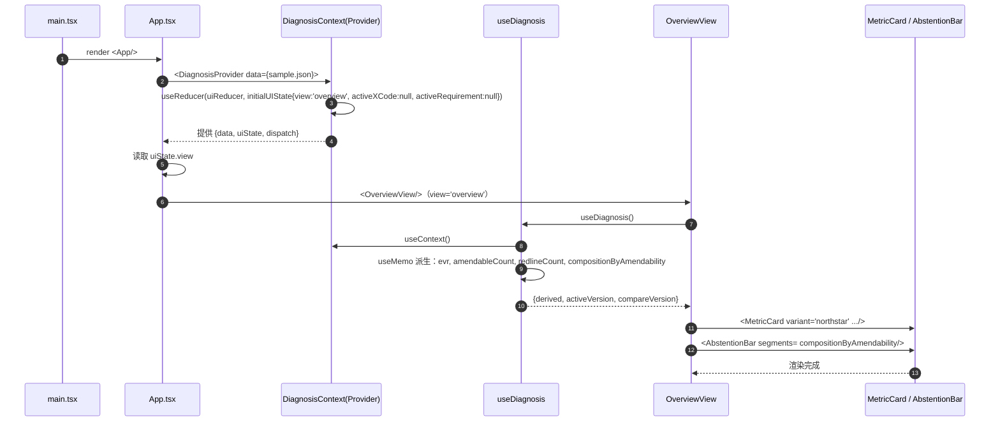
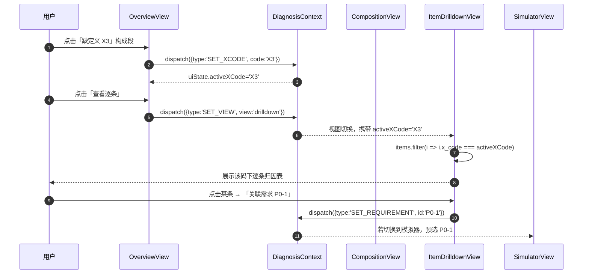
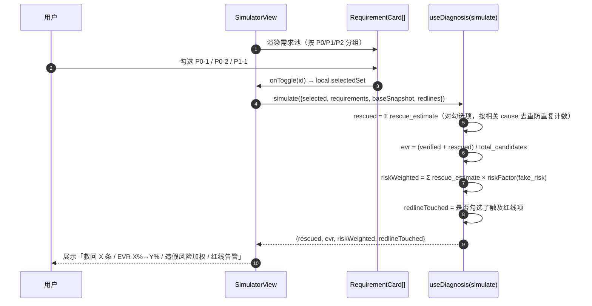
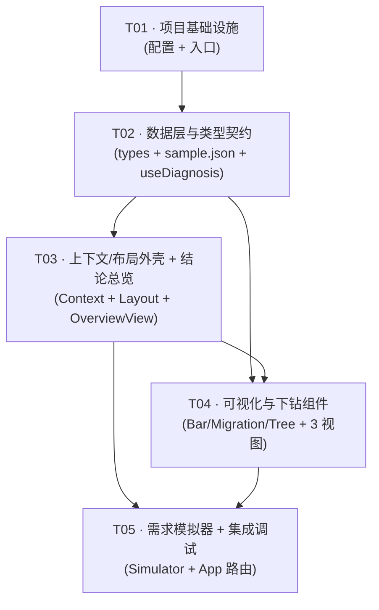

# 明镜 MingJing 弃权率归因诊断看板 · 系统架构设计 + 任务分解

> 类型：系统架构设计 + 任务分解（Part A + Part B）
> 作者：高见远（架构师）
> 上游输入：`docs/deliverables/abstention-prd.md`（许清楚 · 产品经理）
> 交付物：单页 Web 应用（Vite + React + Tailwind CSS），独立于原 Python 内核
> 落盘目录：`docs/deliverables/abstention-dashboard/`
> 设计原则：**不改造原内核**、**弃权是护城河不是缺陷**、**30 秒看懂**

---

## Part A：系统设计

### 1. 实现方案（Implementation Approach）

#### 1.1 核心设计诉求

| 诉求 | 说明 | 对架构的影响 |
| --- | --- | --- |
| 30 秒看懂 | 产品/开发/评审打开即得结论 | 首屏必须是一个「结论层」——弃权构成 + 可改善占比 + 行动入口，不能是原始表格 |
| 叙事正确 | 「可改善 vs 有意保守(红线)」二元区分，禁止暗示降弃权率=好 | 数据模型必须内建 `amendability` / `is_redline` 字段，UI 用中性色表达合法弃权、用高亮色表达可改善空间 |
| 不改造内核 | 内核与看板完全解耦 | 看板只消费一份结构化 JSON（`abstention-diagnosis.v1`），由离线脚本/人工从 `results.json` + coverage 账本转换生成 |
| 高数据密度 | 金融终端/审计工具审美 | 紧凑网格、等宽数字、信息层级靠字重与分隔线而非大量留白 |
| 可下钻 | 143 条逐条归因、根因树、需求池模拟器 | 统一「诊断数据上下文（Context）」+ 受控视图切换，无需路由库 |

#### 1.2 核心技术挑战与选型

**挑战 1：数据形态是「一份快照 + 一次对比」。**
看板不需要后端与实时请求，数据是一份编译期内置的 JSON（`abstention-diagnosis.v1`）。因此放弃任何数据请求库（react-query/axios），改为**构建期静态导入 + 运行时 Context 分发**。

**挑战 2：可视化种类多但彼此独立（构成分解、迁移趋势、根因树、模拟器）。**
不引入重型图表库（ECharts/Recharts），改用**手写 SVG 组件 + CSS**：数据量小（<200 条，<10 个类目）、种类定制化强（迁移趋势需要 04→08 的桑基式箭头、根因树需要联动高亮），通用库反而带来体积与定制负担。仅引入 `d3-scale` 做坐标/比例尺计算（纯函数、零依赖负担）。

**挑战 3：状态在多个下钻视图间共享（选中的 X 码、根因叶子、需求项需联动高亮）。**
不引入 Redux/Zustand，改用 **React Context + useReducer**（单一诊断数据源 + UI 选择态），复杂度可控。

#### 1.3 技术栈选型（团队默认栈，经论证）

| 层次 | 选型 | 版本 | 理由 |
| --- | --- | --- | --- |
| 构建 | Vite | ^5.2.0 | 团队默认；零配置 TS + React；构建期 JSON 导入原生支持 |
| 框架 | React | ^18.2.0 | 团队默认；组件化适合多视图下钻 |
| 语言 | TypeScript | ^5.4.0 | schema 驱动强类型，Props 类型即事实文档 |
| 样式 | Tailwind CSS | ^3.4.0 | 团队默认；原子类便于实现高密度定制设计；**不引入 MUI**（避免默认消费级观感） |
| 比例尺 | d3-scale | ^4.0.2 | 仅用其纯函数做比例尺/区间计算，避免手写坐标映射出错 |
| 图标 | lucide-react | ^0.378.0 | 轻量线性图标，契合金融终端审慎气质；tree-shaking 友好 |

> **为何不用图表库**：所有可视化均为定制形态（构成条、迁移双环、可折叠根因树、滑块模拟器），通用库需大量覆写反而更重；手写 SVG 保证视觉一致与零冗余 JS。

#### 1.4 架构模式

采用 **「单页 + 分层视图」** 模式（近似 MVC 的前端落地）：

```
数据层 (DiagnosisData)  →  上下文层 (DiagnosisContext + reducer)  →  视图层 (Views)  →  展示组件 (Components)
   JSON 静态导入              选择态/派生指标 memo 化                   五个主视图        原子/分子级 UI
```

- **无路由**：五个主视图（结论总览/构成分解/根因树/逐条下钻/需求模拟器）通过顶部分段控件切换，`view` 在 reducer 中管理，避免引入 react-router。
- **派生计算集中**：所有统计（EVR、可改善条数、救回预估）在 `hooks/useDiagnosis.ts` 中用 `useMemo` 派生，保证单一计算源，不散落在组件里。

---

### 2. 文件列表（File List）

根目录：`docs/deliverables/abstention-dashboard/`

```
abstention-dashboard/
├── package.json                                  # 依赖与脚本
├── vite.config.ts                                # Vite 配置
├── tsconfig.json                                 # TS 配置（含 paths 别名 @/*）
├── tailwind.config.ts                            # Tailwind 主题（设计 token）
├── postcss.config.js                             # Tailwind 构建链
├── index.html                                    # 入口 HTML
└── src/
    ├── main.tsx                                  # 应用入口
    ├── App.tsx                                   # 根组件（Provider + 视图切换外壳）
    ├── data/
    │   └── diagnosis.sample.json                 # 内置示例数据（abstention-diagnosis.v1，源自 PRD 真实数字）
    ├── types/
    │   └── diagnosis.ts                          # 全部 TS 类型/schema 类型定义
    ├── context/
    │   └── DiagnosisContext.tsx                  # 数据上下文 + reducer + Provider
    ├── hooks/
    │   └── useDiagnosis.ts                       # 派生指标/筛选/统计 hook
    ├── views/
    │   ├── OverviewView.tsx                      # 结论总览（30 秒看懂首屏）
    │   ├── CompositionView.tsx                   # 弃权构成分解 + X 码迁移趋势(04→08)
    │   ├── RootCauseView.tsx                     # 根因树（可折叠 + 联动高亮）
    │   ├── ItemDrilldownView.tsx                 # 143 条逐条归因下钻表
    │   └── SimulatorView.tsx                     # 需求池 P0/P1/P2 + 救回模拟器
    └── components/
        ├── Layout.tsx                            # 顶栏 + 分段控件 + 页脚（设计气质载体）
        ├── MetricCard.tsx                        # 指标卡（北极星/驱动/反指标三态）
        ├── AbstentionBar.tsx                     # 构成分解水平堆叠条（SVG）
        ├── MigrationChart.tsx                    # X 码迁移双环/箭头图（SVG）
        ├── RootCauseTree.tsx                     # 根因树节点(递归组件)
        ├── AmendmentBadge.tsx                    # 可改善/红线/中性 语义徽章
        ├── RequirementCard.tsx                   # 需求项卡片（救回/成本/造假风险/红线）
        ├── GapKindLegend.tsx                     # GAP_KIND ↔ X 码 图例
        └── ui/
            ├── SegmentedControl.tsx              # 分段控件
            └── Tag.tsx                           # 通用标签/数值片
```

**源文件计数**：配置 6 + 源码 18 = **24 个文件**，其中**源码组件/逻辑文件 18 个**（含 8 个 components、5 个 views、5 个基础设施）。任务分解控制在 **5 个任务**内，按层次分组。

---

### 3. 数据结构与接口（Data Structures & Interfaces）

#### 3.1 JSON Schema：`abstention-diagnosis.v1`

这是看板的**唯一数据契约**。由离线转换脚本/人工从明镜运行产物（`results.json` + coverage 账本 + `ABSTENTION_SMALL_SAMPLE.md`）生成。看板只读消费。

```jsonc
{
  "$schema": "abstention-diagnosis.v1",
  "meta": {
    "report_hash": "66869cb",              // 数据基线 git HEAD
    "report_pages": 44,                    // 研报页数
    "generated_at": "2026-01-01T00:00:00Z",// ISO 8601 UTC
    "primary_version": "stable-04",        // 当前主版本
    "compare_version": "stable-08",        // 迁移对比版本
    "denominator_scope": "all_candidates"  // all_candidates(319) | main_scope(295)  —— Q2 待确认
  },

  // —— 版本快照：每个稳定版本一条 ——
  "versions": [
    {
      "id": "stable-04",
      "label": "stable-04",
      "total_candidates": 319,
      "verified": 6,
      "violated": 0,
      "abstained": 313,
      "x_codes": { "X1": 0, "X2": 42, "X3": 163, "X4": 0, "X5": 0, "X6": 108 },
      "note": "解析能力较弱的基线版本"
    },
    { "id": "stable-08", "label": "stable-08", "total_candidates": 314, "verified": 6, "violated": 0, "abstained": 308,
      "x_codes": { "X1": 0, "X2": 58, "X3": 191, "X4": 0, "X5": 0, "X6": 59 },
      "note": "解析提升后，弃权从 X6 迁移至 X3" }
    // ...stable-02 / stable-05 / stable-11 / stable-16-full
  ],

  // —— X 码字典（语义 + 性质）——
  "x_code_defs": [
    { "code": "X1", "name": "缺少可用事实", "kind": "missing",   "amendability": "amendable", "is_redline": false, "desc": "材料未入库或事实缺失，补材料可改善" },
    { "code": "X2", "name": "公式前提不成立", "kind": "premise",  "amendability": "intentional", "is_redline": true,  "desc": "负/零基数等数学前提不成立，设计上有意保守，不可降" },
    { "code": "X3", "name": "指标/口径定义缺口", "kind": "definition", "amendability": "amendable_partial", "is_redline": false, "desc": "定义库缺登记或口径未声明；部分需用户显式声明，禁止代填" },
    { "code": "X4", "name": "来源冲突",       "kind": "conflict", "amendability": "intentional", "is_redline": true,  "desc": "来源冲突/置信不足，护城河，不可降" },
    { "code": "X5", "name": "缺回溯日期",     "kind": "missing",  "amendability": "amendable", "is_redline": false, "desc": "缺回溯日期，补材料可改善" },
    { "code": "X6", "name": "主体或维度待确认","kind": "mention",  "amendability": "amendable", "is_redline": false, "desc": "原文未写明期间/主体/指标，属解析/语义绑定不足，可改善" }
  ],

  // —— GAP_KINDS 字典（7 类根因类别，含与 X 码的映射）——
  "gap_kind_defs": [
    { "kind": "missing_report",  "name": "缺整份报告",     "x_code": null,   "desc": "基于 item.missing[].period 缺整份报告" },
    { "kind": "missing_detail",  "name": "缺报表明细",     "x_code": null,   "desc": "基于 item.missing[].dimension/label 缺报表明细" },
    { "kind": "definition",      "name": "定义缺口",       "x_code": "X3",   "desc": "券商/数据商自定义口径指标未登记" },
    { "kind": "external",        "name": "需外部来源",     "x_code": "X1",   "desc": "需宿主内核之外的外部来源，政策禁止" },
    { "kind": "mention",         "name": "提及待确认",     "x_code": "X6",   "desc": "原文未写明期间/主体/指标" },
    { "kind": "premise",         "name": "公式前提不成立", "x_code": "X2",   "desc": "负/零基数、CAGR 起止期等数学前提，设计保守" },
    { "kind": "conflict",        "name": "来源冲突",       "x_code": "X4",   "desc": "来源冲突/置信不足" }
  ],

  // —— 弃权构成分解（核验后的精确来源，来自 ABSTENTION_SMALL_SAMPLE.md 143 条）——
  "composition": [
    { "id": "c01", "cause": "来源指标方法未知",        "count": 65, "x_code": "X3", "gap_kind": "definition",
      "amendability": "amendable", "evidence_ref": "第42页集中 54/65", "note": "需券商模板/历史字段字典" },
    { "id": "c02", "cause": "公司总量合并/母公司口径未明示", "count": 20, "x_code": "X3", "gap_kind": "definition",
      "amendability": "needs_user_declaration", "evidence_ref": "source_gap_catalog.py:80", "note": "需用户声明，政策禁止代填" },
    { "id": "c03", "cause": "缺事实或公式操作数",      "count": 12, "x_code": "X1", "gap_kind": "missing_report",
      "amendability": "amendable", "evidence_ref": "item.missing[]", "note": "补材料" },
    { "id": "c04", "cause": "业务或客户口径未知",      "count": 9,  "x_code": "X3", "gap_kind": "definition",
      "amendability": "amendable", "evidence_ref": "source-customer-table 先例", "note": "来源表核查路径" },
    { "id": "c05", "cause": "占比分母或维度不完整",    "count": 9,  "x_code": "X3", "gap_kind": "definition",
      "amendability": "amendable", "evidence_ref": "—", "note": "净利率/占比定义登记" },
    { "id": "c06", "cause": "券商残项绑定及后续依赖",  "count": 8,  "x_code": "X3", "gap_kind": "definition",
      "amendability": "amendable", "evidence_ref": "已修 1 处", "note": "公式登记" },
    { "id": "c07", "cause": "负/零基数规则前提不成立",  "count": 7,  "x_code": "X2", "gap_kind": "premise",
      "amendability": "intentional", "evidence_ref": "verify.py:985", "note": "设计保守·红线" },
    { "id": "c08", "cause": "分部维度不完整",          "count": 6,  "x_code": "X3", "gap_kind": "definition",
      "amendability": "amendable_partial", "evidence_ref": "—", "note": "部分可改善" },
    { "id": "c09", "cause": "原文结构未完成解析",      "count": 5,  "x_code": "X6", "gap_kind": "mention",
      "amendability": "amendable", "evidence_ref": "judge.py:374", "note": "解析增强" },
    { "id": "c10", "cause": "CAGR 起止期不完整",       "count": 2,  "x_code": "X2", "gap_kind": "premise",
      "amendability": "intentional", "evidence_ref": "—", "note": "设计保守·红线" }
  ],

  // —— 根因树（可行动叶子节点）——
  // 【聚合口径】整棵树对齐主版本 stable-04：root = A + B + C 严格自洽。
  //   一级分支 count = stable-04 对应 X 码存量（X3=163 / X6=108 / X2=42）。
  //   叶子 count = PRD §1.3/§1.2 的逐因精确值，为「子集量化」（仅列出有逐条证据的因），
  //   不追求与上级分支等和；未列出部分为无逐条证据的残余量。
  "root_cause_tree": {
    "id": "root", "label": "高弃权率 313（≈98%）· stable-04", "count": 313,
    "aggregation_note": "root=A+B+C 严格自洽；leaf 为子集量化，非穷举",
    "children": [
      { "id": "A", "label": "X3 定义缺口", "count": 163, "x_code": "X3",
        "children": [
          { "id": "A1", "label": "券商自定义指标定义库缺登记", "count": 65, "x_code": "X3", "leaf": true, "actionable": true,  "requirement_ref": "P0-1", "evidence_ref": "FINANCIAL_SOURCE_POLICY.md" },
          { "id": "A2", "label": "口径（合并/母公司）声明缺失", "count": 20, "x_code": "X3", "leaf": true, "actionable": true, "requirement_ref": "P0-3", "evidence_ref": "judge.py:192" },
          { "id": "A3", "label": "双盲绑定未达成一致",        "count": 0,  "x_code": "X3", "leaf": true, "actionable": true,  "requirement_ref": "P0-2", "evidence_ref": "judge.py:375" },
          { "id": "A4", "label": "占比分母/维度不完整",       "count": 9,  "x_code": "X3", "leaf": true, "actionable": true,  "requirement_ref": "P1-3", "evidence_ref": "—" },
          { "id": "A5", "label": "券商残项公式依赖",          "count": 8,  "x_code": "X3", "leaf": true, "actionable": true,  "requirement_ref": "P1-4", "evidence_ref": "—" }
        ] },
      { "id": "B", "label": "X6 主体/维度待确认", "count": 108, "x_code": "X6",
        "children": [
          { "id": "B1", "label": "原文结构未完整解析", "count": 5, "x_code": "X6", "leaf": true, "actionable": true, "requirement_ref": "P1-1", "evidence_ref": "judge.py:374" },
          { "id": "B2", "label": "未确定期间/币种/单位","count": 0, "x_code": "X6", "leaf": true, "actionable": true, "requirement_ref": "P1-1", "evidence_ref": "judge.py:818" },
          { "id": "B3", "label": "主体待确认",          "count": 0, "x_code": "X6", "leaf": true, "actionable": true, "requirement_ref": "P1-2", "evidence_ref": "judge.py:962" }
        ] },
      { "id": "C", "label": "X2 公式前提不成立", "count": 42, "x_code": "X2",
        "children": [
          { "id": "C1", "label": "负/零基数",        "count": 7, "x_code": "X2", "leaf": true, "actionable": false, "redline": true, "requirement_ref": null, "evidence_ref": "verify.py:985" },
          { "id": "C2", "label": "CAGR 起止期不完整","count": 2, "x_code": "X2", "leaf": true, "actionable": false, "redline": true, "requirement_ref": null, "evidence_ref": "—" },
          { "id": "C3", "label": "无登记公式",        "count": 0, "x_code": "X2", "leaf": true, "actionable": true,  "redline": false, "requirement_ref": "P1-4", "evidence_ref": "judge.py:389" }
        ] }
    ]
  },

  // —— 143 条逐条归因（下钻表，PRD §1.2 精确来源；此处示 3 条样例，实际 143 条）——
  "items": [
    { "id": "i0001", "page": 42, "seq": 5, "raw_label": "承销净收入率", "x_code": "X3", "gap_kind": "definition",
      "cause": "来源指标方法未知", "amendability": "amendable", "evidence_ref": "第42页", "requirement_ref": "P0-1" },
    { "id": "i0002", "page": 12, "seq": 31, "raw_label": "营业收入（合并）", "x_code": "X3", "gap_kind": "definition",
      "cause": "公司总量合并/母公司口径未明示", "amendability": "needs_user_declaration", "evidence_ref": "source_gap_catalog.py:80", "requirement_ref": "P0-3" },
    { "id": "i0003", "page": 8,  "seq": 12, "raw_label": "同比增长率", "x_code": "X2", "gap_kind": "premise",
      "cause": "负/零基数规则前提不成立", "amendability": "intentional", "evidence_ref": "verify.py:985", "requirement_ref": null }
    // ...
  ],

  // —— 改进需求池 ——
  "requirements": [
    { "id": "P0-1", "priority": "P0", "title": "券商/数据商指标定义登记库",
      "rescue_estimate": 65, "cost": "中", "fake_risk": "低", "is_redline": false,
      "linked_causes": ["c01"], "linked_root_leaves": ["A1"],
      "redline_constraint": "定义必须带来源（模板/字段字典哈希），禁止凭常见财经公式猜测" },
    { "id": "P0-2", "priority": "P0", "title": "前置 guard 短路修复",
      "rescue_estimate": 130, "cost": "中", "fake_risk": "中", "is_redline": false,
      "linked_causes": [], "linked_root_leaves": ["A3"],
      "redline_constraint": "内核取数仍只接受已登记事实，不得因『能查』放宽定义权限" },
    { "id": "P0-3", "priority": "P0", "title": "口径声明澄清入口",
      "rescue_estimate": 20, "cost": "低", "fake_risk": "中", "is_redline": false,
      "linked_causes": ["c02"], "linked_root_leaves": ["A2"],
      "redline_constraint": "绝对不能代填口径，必须用户有来源声明" },
    { "id": "P0-4", "priority": "P0", "title": "有效核实率 + 缺口可闭环率指标看板",
      "rescue_estimate": 0, "cost": "低-中", "fake_risk": "无", "is_redline": false,
      "linked_causes": [], "linked_root_leaves": [], "redline_constraint": "指标须区分已核查与合法弃权，防止刷指标" },
    { "id": "P1-1", "priority": "P1", "title": "结构解析增强", "rescue_estimate": 59, "cost": "中", "fake_risk": "低",
      "is_redline": false, "linked_causes": ["c09"], "linked_root_leaves": ["B1","B2"],
      "redline_constraint": "解析只产出『待审』不产出判定" },
    { "id": "P1-2", "priority": "P1", "title": "来源表核查路径推广", "rescue_estimate": 40, "cost": "中", "fake_risk": "低",
      "is_redline": false, "linked_causes": ["c04"], "linked_root_leaves": ["B3"],
      "redline_constraint": "按发行人+引用+期间取数，金额不参与选源" },
    { "id": "P1-3", "priority": "P1", "title": "占比/净利率分母定义登记", "rescue_estimate": 9, "cost": "低", "fake_risk": "低",
      "is_redline": false, "linked_causes": ["c05"], "linked_root_leaves": ["A4"], "redline_constraint": "分母必须原文显式，禁止猜测" },
    { "id": "P1-4", "priority": "P1", "title": "券商残项公式补齐", "rescue_estimate": 8, "cost": "低-中", "fake_risk": "中",
      "is_redline": false, "linked_causes": ["c06"], "linked_root_leaves": ["A5","C3"],
      "redline_constraint": "公式须逐项登记组成行，禁止原表内部相加当外部核实" },
    { "id": "P2-1", "priority": "P2", "title": "分部维度完整性提升", "rescue_estimate": 6, "cost": "中", "fake_risk": "中",
      "is_redline": false, "linked_causes": ["c08"], "linked_root_leaves": [], "redline_constraint": "需明确维度来源" },
    { "id": "P2-2", "priority": "P2", "title": "缺材料指引自动化", "rescue_estimate": 0, "cost": "低", "fake_risk": "无",
      "is_redline": false, "linked_causes": [], "linked_root_leaves": [], "redline_constraint": null },
    { "id": "P2-3", "priority": "P2", "title": "外部数据源接入", "rescue_estimate": 0, "cost": "高", "fake_risk": "中",
      "is_redline": false, "linked_causes": [], "linked_root_leaves": [], "redline_constraint": "外部源须独立登记，不得与宿主事实混用" }
  ],

  // —— 不做清单（红区）——
  "redlines": [
    { "id": "R1", "forbidden": "负/零基数强行计算（X2，7 条）", "reason": "数学前提不成立", "evidence_ref": "verify.py:985", "count": 7 },
    { "id": "R2", "forbidden": "CAGR 跨报告拼接（2 条）", "reason": "无同一报告版本", "evidence_ref": "ABSTENTION_SMALL_SAMPLE.md", "count": 2 },
    { "id": "R3", "forbidden": "凭金额巧合/双模型一致升格定义", "reason": "造假风险", "evidence_ref": "FINANCIAL_SOURCE_POLICY.md", "count": 0 },
    { "id": "R4", "forbidden": "代填合并口径/默认合并", "reason": "无来源授权", "evidence_ref": "FINANCIAL_SOURCE_POLICY.md", "count": 0 },
    { "id": "R5", "forbidden": "用相近数值选择更接近的口径", "reason": "选择偏差", "evidence_ref": "ABSTENTION_SMALL_SAMPLE.md", "count": 0 }
  ],

  // —— 指标体系 ——
  "metrics": {
    "north_star": {
      "name": "有效核实率 EVR", "formula": "(verified+violated)/total_candidates",
      "current_value": 0.019, "unit": "ratio",
      "stages": [ { "label": "现状", "value": 0.019 }, { "label": "阶段一", "value": 0.15 }, { "label": "阶段二", "value": 0.35 } ],
      "guardrail": "verified 精确率 ≥98%"
    },
    "drivers": [
      { "name": "事实查询执行率", "current_value": 0.59, "target": 0.85, "leverage": "P0-2" },
      { "name": "定义覆盖率",     "current_value": 0.10, "target": 0.60, "leverage": "P0-1" },
      { "name": "解析完成率",     "current_value": 0.55, "target": 0.90, "leverage": "P1-1" },
      { "name": "口径声明覆盖率", "current_value": 0.00, "target": 0.80, "leverage": "P0-3" }
    ],
    "outcomes": [
      { "name": "缺口可闭环率",   "current_value": 0.30, "target": 0.80 },
      { "name": "verified 精确率","current_value": null, "target": 0.98, "status": "待确认（需真人盲标）" },
      { "name": "首次核查有效产出率", "current_value": null, "target": null }
    ],
    "counter_metrics": [
      { "name": "verified 但无内核来源比例", "value": 0, "threshold": 0, "must_be_zero": true },
      { "name": "凭数值巧合判定数",         "value": 0, "threshold": 0, "must_be_zero": true },
      { "name": "定义猜测登记数",           "value": 0, "threshold": 0, "must_be_zero": true }
    ]
  }
}
```

#### 3.2 JSON 字段字典（关键字段）

| 字段路径 | 类型 | 必填 | 说明 |
| --- | --- | --- | --- |
| `meta.denominator_scope` | enum | ✓ | `all_candidates`(319) 或 `main_scope`(295) —— 决定 EVR 分母（PRD Q2） |
| `versions[].x_codes` | Record<XCode, number> | ✓ | 六码分布，三码恒等于弃权总数 |
| `x_code_defs[].amendability` | enum | ✓ | `amendable` / `amendable_partial` / `needs_user_declaration` / `intentional`；驱动 UI 颜色语义 |
| `x_code_defs[].is_redline` | boolean | ✓ | 是否为理念红线（X2/X4=true） |
| `composition[].amendability` | enum | ✓ | 同 `amendability`；构成分解着色依据 |
| `root_cause_tree.count` | number | ✓ | **整树对齐主版本 stable-04**：root=313=A(163)+B(108)+C(42)，一级分支=对应 X 码存量，必须严格自洽 |
| `root_cause_tree.aggregation_note` | string | ✓ | 聚合口径说明；叶子为「子集量化」，不追求与上级等和 |
| `root_cause_tree[].leaf` | boolean | ✓ | 是否可行动叶子 |
| `root_cause_tree[].requirement_ref` | string \| null | ✓ | 关联需求 ID，用于根因树↔需求池联动 |
| `items[].amendability` | enum | ✓ | 逐条归因的可改善性 |
| `requirements[].rescue_estimate` | number | ✓ | 救回弃权条数（模拟器输入） |
| `requirements[].fake_risk` | enum | ✓ | `无` / `低` / `中` / `高`，模拟器加权 |
| `metrics.counter_metrics[].must_be_zero` | boolean | ✓ | 反指标，UI 需红色告警当 >0 |
| `redlines[].count` | number | ✓ | 涉及条数（不可动的合法弃权） |

#### 3.3 TypeScript 类型定义（`src/types/diagnosis.ts`）

```typescript
export type XCode = 'X1' | 'X2' | 'X3' | 'X4' | 'X5' | 'X6';
export type GapKind = 'missing_report' | 'missing_detail' | 'definition' | 'external' | 'mention' | 'premise' | 'conflict';
export type Amendability = 'amendable' | 'amendable_partial' | 'needs_user_declaration' | 'intentional';
export type Priority = 'P0' | 'P1' | 'P2';
export type FakeRisk = '无' | '低' | '中' | '高';

export interface DiagnosisMeta {
  report_hash: string; report_pages: number; generated_at: string;
  primary_version: string; compare_version: string;
  denominator_scope: 'all_candidates' | 'main_scope';
}
export interface VersionSnapshot {
  id: string; label: string; total_candidates: number;
  verified: number; violated: number; abstained: number;
  x_codes: Record<XCode, number>; note?: string;
}
export interface XCodeDef { code: XCode; name: string; kind: GapKind; amendability: Amendability; is_redline: boolean; desc: string; }
export interface GapKindDef { kind: GapKind; name: string; x_code: XCode | null; desc: string; }
export interface CompositionEntry {
  id: string; cause: string; count: number; x_code: XCode; gap_kind: GapKind;
  amendability: Amendability; evidence_ref: string; note: string;
}
export interface RootCauseNode {
  id: string; label: string; count: number; x_code?: XCode;
  aggregation_note?: string; // 仅根节点：说明 leaf 为子集量化
  leaf?: boolean; actionable?: boolean; redline?: boolean;
  requirement_ref?: string | null; evidence_ref?: string; children?: RootCauseNode[];
}
export interface DiagnosisItem {
  id: string; page: number; seq: number; raw_label: string; x_code: XCode;
  gap_kind: GapKind; cause: string; amendability: Amendability;
  evidence_ref: string; requirement_ref: string | null;
}
export interface Requirement {
  id: string; priority: Priority; title: string; rescue_estimate: number;
  cost: string; fake_risk: FakeRisk; is_redline: boolean;
  linked_causes: string[]; linked_root_leaves: string[];
  redline_constraint: string | null;
}
export interface Redline { id: string; forbidden: string; reason: string; evidence_ref: string; count: number; }
export interface MetricStage { label: string; value: number; }
export interface NorthStarMetric { name: string; formula: string; current_value: number; unit: string; stages: MetricStage[]; guardrail: string; }
export interface DriverMetric { name: string; current_value: number; target: number | null; leverage: string; }
export interface OutcomeMetric { name: string; current_value: number | null; target: number | null; status?: string; }
export interface CounterMetric { name: string; value: number; threshold: number; must_be_zero: boolean; }
export interface Metrics { north_star: NorthStarMetric; drivers: DriverMetric[]; outcomes: OutcomeMetric[]; counter_metrics: CounterMetric[]; }

export interface DiagnosisData {
  meta: DiagnosisMeta; versions: VersionSnapshot[]; x_code_defs: XCodeDef[]; gap_kind_defs: GapKindDef[];
  composition: CompositionEntry[]; root_cause_tree: RootCauseNode; items: DiagnosisItem[];
  requirements: Requirement[]; redlines: Redline[]; metrics: Metrics;
}
```

#### 3.4 组件 Props 类型（关键组件）

```typescript
// components/Layout.tsx
interface LayoutProps { view: ViewKey; onViewChange: (v: ViewKey) => void; children: React.ReactNode; }
export type ViewKey = 'overview' | 'composition' | 'rootcause' | 'drilldown' | 'simulator';

// components/MetricCard.tsx  —— 三态：北极星/驱动/反指标
interface MetricCardProps {
  variant: 'northstar' | 'driver' | 'counter';
  title: string; value: number | null; target?: number | null;
  unit?: 'ratio' | 'count'; formula?: string; guardrail?: string;
  stages?: MetricStage[]; leverage?: string; isAlert?: boolean; // counter 用
}

// components/AbstentionBar.tsx —— 构成分解水平堆叠条
interface AbstentionBarProps {
  segments: { id: string; label: string; count: number; amendability: Amendability }[];
  total: number; onSegmentClick?: (id: string) => void; activeId?: string | null;
}

// components/MigrationChart.tsx —— X 码迁移（from/to 版本）
interface MigrationChartProps { from: VersionSnapshot; to: VersionSnapshot; }

// components/RootCauseTree.tsx
interface RootCauseTreeProps {
  node: RootCauseNode; depth?: number;
  expanded: Set<string>; onToggle: (id: string) => void;
  activeRequirement?: string | null;
}

// components/AmendmentBadge.tsx
interface AmendmentBadgeProps { amendability: Amendability; compact?: boolean; }

// components/RequirementCard.tsx
interface RequirementCardProps {
  requirement: Requirement; selected: boolean; onToggle: (id: string) => void;
}

// views/SimulatorView.tsx 内部派生
interface SimResult { rescued: number; evr: number; riskWeighted: number; redlineTouched: boolean; }
```

---

### 4. 程序调用流程（Program Call Flow）

#### 4.1 应用初始化与派生计算



#### 4.2 下钻交互（结论 → 构成 → 逐条 → 需求联动）



#### 4.3 需求模拟器（「能救回多少条」）



> **模拟器关键约定**：救回条数按 `linked_causes` 去重（多条需求指向同一 cause 时不重复计数），并对 `fake_risk` 做加权展示（`无=0, 低=0.1, 中=0.3, 高=0.6`），当 `is_redline=true` 项被勾选时弹出红线告警（本样本 P 项无 redline=true，但 UI 逻辑需具备）。

---

### 5. 待明确事项（Anything UNCLEAR）

| # | 事项 | 影响 | 本设计的处理 / 假设 |
| --- | --- | --- | --- |
| U1 | EVR 分母：全部候选(319) vs 主范围(295)（PRD Q2） | 决定北极星数值 | 由 `meta.denominator_scope` 驱动，默认 `all_candidates`；UI 提供切换，两值都展示 |
| U2 | 事实查询执行率 59% 是否准确（PRD Q6） | 驱动指标基线 | 示例数据沿用 PRD 的 ≈59%，标注「待逐条核验」 |
| U3 | `stable-16-full` 仅 198 弃权/97 verified，与主版本差异大 | 是否需要纳入多版本对比 | `versions[]` 全收录，但首页迁移对比默认 stable-04↔stable-08（PRD 叙事主线） |
| U4 | 143 条逐条清单的完整原始数据（仅 PRD 提供首因分组计数） | 下钻表精度 | 示例 JSON 按「首因分组 × 计数」展开为占位条目（≥10 条真实样例），**真实 143 条需离线脚本导入**；已在 schema 中预留 `items[]` 完整结构 |
| U5 | 「口径声明覆盖率」现状标注为 0（未代填） | 驱动指标显示 | 保留 0，UI 强调「0 是正确状态（未代填）」，不渲染为缺陷 |
| U6 | verified 精确率 / 首次核查有效产出率 现状为 unknown | 结果指标卡 | `current_value=null` → UI 渲染「待确认（需真人盲标）」，不显示 0 |
| U7 | 券商模板/公式表能否合法获取（PRD Q1） | P0-1 救回上限 | 看板不改动，仅把该开放性写入需求项 `redline_constraint` 提示 |
| U8 | 是否需要多版本时间序列折线 | 是否需要额外图表组件 | 当前版本快照 6 条已足够做迁移对比；若需趋势线，`MigrationChart` 可扩展为多版本模式（列为 P2 增强，不阻塞） |

---

## Part B：任务分解

### 6. 依赖包列表（Required Packages）

```
# —— 运行时依赖 ——
react@^18.2.0                      # UI 框架
react-dom@^18.2.0                  # React DOM
d3-scale@^4.0.2                    # 比例尺/区间纯函数（构成条、迁移图坐标）
lucide-react@^0.378.0              # 线性图标（审慎气质，tree-shaking 友好）

# —— 开发依赖 ——
vite@^5.2.0                        # 构建工具
@vitejs/plugin-react@^4.2.0        # React 插件（Babel/SWC）
typescript@^5.4.0                  # 类型系统
@types/react@^18.2.0               # React 类型
@types/react-dom@^18.2.0           # ReactDOM 类型
@types/d3-scale@^4.0.8             # d3-scale 类型
tailwindcss@^3.4.0                 # 原子 CSS
postcss@^8.4.0                     # Tailwind 构建链
autoprefixer@^10.4.0               # 浏览器前缀
```

> 说明：**不引入** MUI、react-router、axios、ECharts/Recharts、状态管理库 —— 理由见 §1.3。

### 7. 任务列表（Task List，按依赖顺序）

> **硬性约束**：共 **5 个任务**（≤5），每个任务含 ≥3 个相关文件，第一个任务为项目基础设施，按功能模块分组。

---

#### T01 · 项目基础设施（P0）

| 项 | 内容 |
| --- | --- |
| **源文件** | `package.json`、`vite.config.ts`、`tsconfig.json`、`tailwind.config.ts`、`postcss.config.js`、`index.html`、`src/main.tsx` |
| **依赖** | 无 |
| **优先级** | P0 |

**交付内容**：
- 初始化 Vite + React + TS + Tailwind 工程骨架，配置 `@/*` 路径别名。
- `tailwind.config.ts` 注入**设计 token**（见 §8）：中性弃权色板、可改善高亮色板、警戒红、等宽数字字体。
- `index.html` 设置 `<html lang="zh-CN">`、深色终端底色、`font-feature-settings: 'tnum'`。
- `src/main.tsx` 挂载 `<App/>`（App 由 T05 完成，本任务先放占位）。

**验收要点**：
- [ ] `npm run dev` 可启动，页面显示占位内容，无 TS/构建报错。
- [ ] `npx tsc --noEmit` 通过。
- [ ] Tailwind 自定义 token 在页面可生效（做一个最小色块验证后移除）。

---

#### T02 · 数据层与类型契约（P0）

| 项 | 内容 |
| --- | --- |
| **源文件** | `src/types/diagnosis.ts`、`src/data/diagnosis.sample.json`、`src/hooks/useDiagnosis.ts` |
| **依赖** | T01 |
| **优先级** | P0 |

**交付内容**：
- 完整实现 §3.3 的全部 TypeScript 类型（`DiagnosisData` 及其所有子类型）。
- 编写 `diagnosis.sample.json`：严格遵循 `abstention-diagnosis.v1`，数字全部来自 PRD（versions 全收录、composition 10 条、root_cause_tree 完整、requirements 11 条、redlines 5 条、metrics 完整、items ≥10 条真实样例）。
- 实现 `useDiagnosis.ts`：读取 data + Context，用 `useMemo` 派生 `evr`、`amendableCount`、`redlineCount`、`compositionByAmendability`、`itemsByXCode` 等；实现 `simulate()` 纯函数（救回去重 + 风险加权 + 红线检测）。

**验收要点**：
- [ ] `diagnosis.sample.json` 通过一个校验函数（`validateDiagnosis()`），关键计数自洽：如 stable-04 `163+42+108=313=abstained`。
- [ ] `useDiagnosis` 派生出的 EVR ≈ 1.9%（6/319）。
- [ ] `simulate({selected:['P0-1','P0-2']})` 返回 `rescued≈195`（≥0 且不重复计数）。

---

#### T03 · 上下文与布局外壳 + 结论总览视图（P0）

| 项 | 内容 |
| --- | --- |
| **源文件** | `src/context/DiagnosisContext.tsx`、`src/components/Layout.tsx`、`src/components/ui/SegmentedControl.tsx`、`src/components/ui/Tag.tsx`、`src/views/OverviewView.tsx` |
| **依赖** | T02 |
| **优先级** | P0 |

**交付内容**：
- `DiagnosisContext.tsx`：`uiReducer`（`view` / `activeXCode` / `activeRequirement` 选择态）+ Provider；导出 `useDiagnosisContext`。
- `Layout.tsx`：顶栏（报告标题 + 版本标签 + 数据基线 hash）、分段控件（五视图切换）、页脚（红线声明「弃权是护城河，不是缺陷」）。
- `SegmentedControl.tsx` / `Tag.tsx`：原子 UI。
- `OverviewView.tsx`：**30 秒看懂首屏** —— 北极星 EVR 大卡 + 「弃权 313 拆解为一句话结论」（可改善 X 条 / 合法保守 Y 条）+ 四条驱动指标条 + 三条反指标（=0 绿标）+ 一键跳转构成分解。

**验收要点**：
- [ ] 首屏在 30 秒内可读出一条结论句：「313 弃权 = 可改善 N 条（X1/X3/X6）+ 有意保守 M 条（X2/X4）」。
- [ ] 反指标区域在数值为 0 时显示「合规」绿标，>0 时显示红色告警（逻辑具备）。
- [ ] 分段控件切换有反馈，但未实现视图显示占位。

---

#### T04 · 可视化与下钻组件（P0）

| 项 | 内容 |
| --- | --- |
| **源文件** | `src/components/MetricCard.tsx`、`src/components/AbstentionBar.tsx`、`src/components/MigrationChart.tsx`、`src/components/RootCauseTree.tsx`、`src/components/AmendmentBadge.tsx`、`src/components/GapKindLegend.tsx`、`src/views/CompositionView.tsx`、`src/views/RootCauseView.tsx`、`src/views/ItemDrilldownView.tsx` |
| **依赖** | T02、T03 |
| **优先级** | P0 |

**交付内容**：
- `MetricCard`：三态（northstar/driver/counter），支持 stages 阶段目标刻度、null→「待确认」。
- `AbstentionBar`：水平堆叠条，按 `amendability` 着色（中性色=保守，高亮=可改善），段可点击（触发 `SET_XCODE`）。
- `MigrationChart`：stable-04↔stable-08 双环/箭头图，突出 X6 108→59、X3 163→191 的迁移。
- `RootCauseTree`：递归可折叠树，叶子联动 `activeRequirement` 高亮。
- `AmendmentBadge` / `GapKindLegend`：语义徽章与图例。
- `CompositionView`：AbstentionBar + 10 条 cause 明细表 + 迁移图 + 图例。
- `RootCauseView`：根因树 + 右侧叶子详情（证据 ref、关联需求）。
- `ItemDrilldownView`：143 条表（按 activeXCode/cause 筛选，分页或虚拟滚动），逐条展示 x_code/cause/amendability/evidence_ref/关联需求。

**验收要点**：
- [ ] 构成分解中「可改善」段与「有意保守」段颜色语义正确（守则有对照测试）。
- [ ] 迁移图正确反映 X6↓/X3↑，数字与 versions 一致。
- [ ] 根因树可展开/折叠；点击叶子能定位到关联需求。
- [ ] 下钻表可按 X 码筛选，行数与 `items` 一致。

---

#### T05 · 需求模拟器 + 集成与最终调试（P0）

| 项 | 内容 |
| --- | --- |
| **源文件** | `src/components/RequirementCard.tsx`、`src/views/SimulatorView.tsx`、`src/App.tsx` |
| **依赖** | T03、T04 |
| **优先级** | P0 |

**交付内容**：
- `RequirementCard`：展示 `rescue_estimate / cost / fake_risk / redline_constraint`，可勾选；`is_redline` 项特殊标注。
- `SimulatorView`：P0/P1/P2 分组需求池 + 勾选 → `simulate()` 实时展示「救回条数 / EVR 现值→模拟值 / 风险加权值 / 红线告警」；含「不做清单」红区展示。
- `App.tsx`：完成 Provider 包裹 + `view` 到五视图的路由切换（替换 T01 占位），串联全部组件。

**验收要点**：
- [ ] 勾选 P0-1+P0-2 后 EVR 从 ~1.9% 上升且救回条数与需求 `rescue_estimate` 一致（去重逻辑正确）。
- [ ] 「不做清单」红区正确渲染 5 条红线及其理由/证据。
- [ ] 五视图全部可访问、无 console 报错，`npx tsc --noEmit` 与 `npm run build` 通过。
- [ ] 全流程「结论 → 构成 → 根因 → 逐条 → 需求」下钻链路可走通。

---

### 8. 共享知识（Shared Knowledge / 跨文件约定）

#### 8.1 设计气质与配色语义（前端执行依据）

| 语义 | 用途 | 色相建议 | Tailwind token |
| --- | --- | --- | --- |
| **背景（终端底）** | 页面底、面板底 | 极深中性灰，非纯黑 | `bg-base: #0B0E13` / `bg-panel: #141821` |
| **合法弃权（中性）** | X2/X4、premise/conflict 类 | **克制的冷灰/石板色**，绝不使用错误红 | `abstain: #6B7280` / `abstain-muted: #4B5563` |
| **可改善空间（高亮）** | X1/X3/X6、amendable 类 | 单一强调色（琥珀/青，用于「机会」而非「错误」） | `improve: #38BDF8`（青）/ `improve-alt: #F59E0B`（琥珀） |
| **待用户声明** | needs_user_declaration | 紫色系区分（需人工介入） | `declare: #A78BFA` |
| **警戒（反指标 >0 / 红线触碰）** | 反指标告警、红线告警 | 仅在真正违规时用红 | `alert: #EF4444` |
| **文本** | 主/次/弱 | `text-primary:#E5E7EB` / `text-secondary:#9CA3AF` / `text-muted:#6B7280` |
| **分隔线/边框** | 面板边框、网格线 | `border:#1F2937` |

> **核心叙事约定**：弃权默认用中性冷灰表达（**它们是理性的、被尊重的**）；只有「可改善空间」和「真正的违规」使用高饱和色。

#### 8.2 字体与排版

- 字体族：`-apple-system, "Segoe UI", "PingFang SC", "Microsoft YaHei", sans-serif`。
- **数字一律等宽 + tabular figures**：`font-variant-numeric: tabular-nums`（金融终端观感，列对齐）。
- 字号阶梯：`12 / 13 / 14 / 16 / 20 / 28`（高密度，避免大留白）；标题用 `font-semibold`，正文 `font-normal`。
- 布局：12 列网格，面板间距 `gap-3`，卡片内边距 `p-4`；信息层级靠**分隔线与字重**，而非大面积留白。

#### 8.3 组件命名与文件约定

- 组件文件 `PascalCase.tsx`，每个文件默认导出一个同名组件。
- 视图统一以 `View` 结尾（`OverviewView` 等），组件不含 `View` 后缀。
- Props 接口同文件导出，命名 `<Component>Props`。
- 原子 UI 放 `components/ui/`；业务组件放 `components/`。

#### 8.4 数据流约定

- **单一数据源**：所有组件只从 `DiagnosisContext` 取 `data` 与 `uiState`，**禁止组件内硬编码 PRD 数字**（数字只存 `diagnosis.sample.json`）。
- **派生计算只在 `useDiagnosis`**：任何统计（EVR、计数、分组）必须经 hook 派生，禁止在视图里重算。
- **选择态最小化**：`uiState` 只存 `view / activeXCode / activeRequirement`；`expanded`（树展开）可放视图本地 state。
- 所有比例值以 **0–1 小数** 存储，展示时统一乘 100 加 `%`。
- 所有日期/时间字符串一律 **ISO 8601 UTC**。
- 联动键统一：X 码用 `XCode` 枚举字符串；需求用 `P0-1` 字符串；cause 用 `c01` 字符串；根因叶子用 `A1` 字符串。

#### 8.5 红线相关硬约定（不可违反）

- 任何 UI 文案**禁止**出现「降低弃权率」这类价值判断；统一用「提升有效核实率 / 扩大可核实覆盖」。
- 「不做清单」`redlines[]` 必须在模拟器视图显式展示，且当模拟触及 `is_redline=true` 需求时弹红线告警。
- 反指标区域数值为 0 时显示「合规」，>0 时显示红色告警；不得把 0 渲染成「无数据」。

---

### 9. 任务依赖图（Task Dependency Graph）



**依赖说明**：
- 严格线性链：`T01 → T02`。
- `T03` 与 `T04` 均依赖 `T02`（数据契约）；`T04` 另依赖 `T03`（`Layout`/原子 UI 复用）。二者仍有顺序（T04 复用 T03 的 SegmentedControl/Tag）。
- `T05` 汇聚全部，做最终集成与调试。

---

## 附录：设计决策速查

| 决策 | 取舍 | 理由 |
| --- | --- | --- |
| 无后端、构建期内置 JSON | ✓ | 数据是单次快照，不需要服务端；降低部署复杂度 |
| 无图表库，手写 SVG | ✓ | 可视化形态定制强、数据量小，通用库反成负担 |
| 无路由库，Context 管视图 | ✓ | 仅 5 视图、单页，路由成本 > 收益 |
| 中性色表达弃权、高亮色表达机会 | ✓ | 严守「弃权是护城河」的产品叙事红线 |
| 类型即 schema | ✓ | TS 类型完整覆盖 JSON 结构，作为唯一事实文档 |
