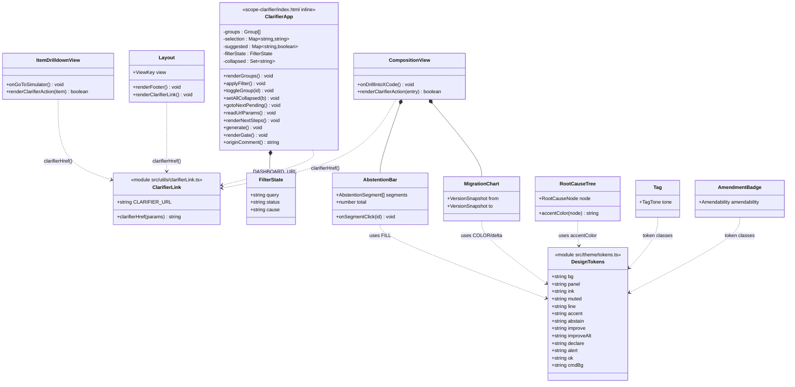
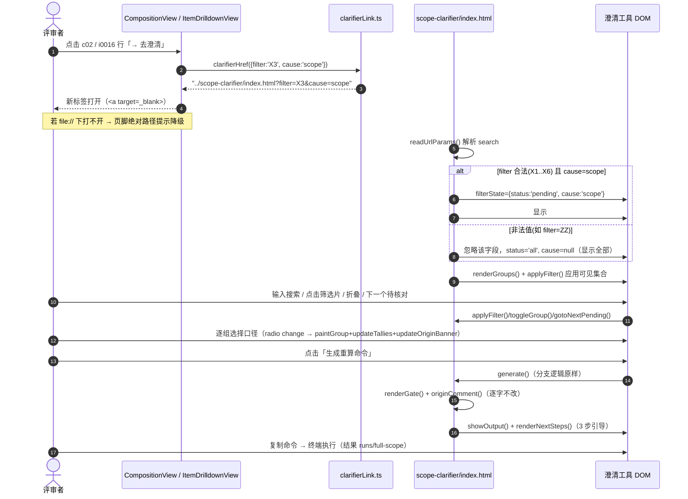
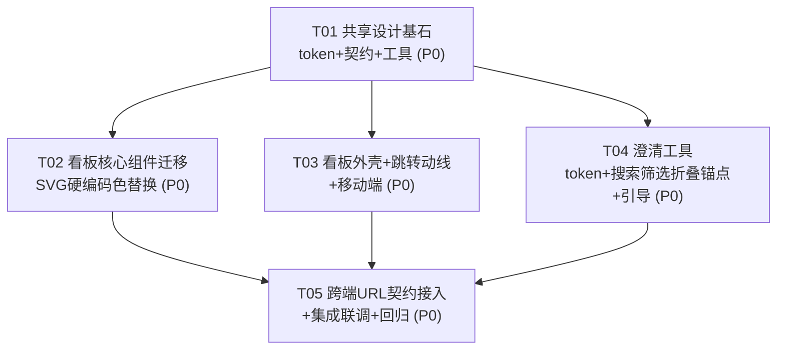

# 明镜双端 UI 体验重构 · 系统设计与任务分解

> 作者：高见远（架构师）
> 输入：`docs/deliverables/ui-optimization/PRD-lite.md`（19 条需求 / 9 条叙事红线 / Q1–Q7）
> 产出范围：`scope-clarifier/index.html`（原生单文件）+ `abstention-dashboard/`（React18+Vite5+TS5+Tailwind3）
> 性质：**体验与视觉重构 + 一个跨端跳转动线**。**不新增后端、不改内核、不改命令语义**。
> 语言：中文。本文件含不写完整实现代码，关键处仅给片段/表。

---

## 0. 决策摘要（先给结论，逐条对应 PRD §7 待确认问题）

| # | 问题 | **架构师裁定** | 依据 |
| --- | --- | --- | --- |
| **Q1** | 看板→澄清工具的**跳转载体** | **约定两端同源访问：都以「同一静态根」下的相对路径互跳**。看板侧定义单一常量 `CLARIFIER_URL`（默认 `../scope-clarifier/index.html`，可用 `VITE_CLARIFIER_URL` 环境变量覆盖）；澄清工具侧定义 `DASHBOARD_URL`（默认 `../abstention-dashboard/index.html`）。**降级行为**：若点击后 `window.open` 返回 `null`（被拦截）或当前为 `file://` 且目标不存在，则 `toast/内联提示` 显示「无法打开澄清工具，请在同一静态服务器下访问 `docs/deliverables/`，或在浏览器打开 `<绝对路径>`」。**不引入任何后端。** | 见 §4.4 / §5 |
| **Q2** | `cause` 枚举与 `composition[].cause`/`items[].cause` 对齐 | **定义 4 个 `cause` 关键词**：`scope`（口径/合并-母公司）、`definition`（定义/方法未知）、`mention`（主体/维度/期间未确认）、`premise`（前提不成立：负零基数/CAGR/无登记公式）。给出**精确映射表**见 §5.2。`filter=X3` 与 `cause=scope` 在澄清工具侧**取交集为「口径类组」**（`caliber_hint` 含「合并/母公司」的组）。 | 见 §5.2 |
| **Q3** | 澄清工具是否需要「反向参数」 | **本次只做 P2 的静态反向入口（DASH-7）**：澄清工具顶栏提供指向看板的普通链接（新标签），**不带**「我已澄清 N 组」状态回填（无后端、无持久化）。 | PRD D2、Out of Scope |
| **Q4** | **浅色 token 最终色板** | **以澄清工具现有浅色为基准提炼并统一**（不重新发明），补齐看板迁移映射。精确十六进制 + 对比度见 §2。正文 `#1F2A37` 对底 `#F5F7FA` ≈ **13.0:1**，弱化文字 `#5C6B7A` 对白 ≈ **5.1:1**，均 ≥ 4.5:1（满足 DASH-1）。 | 见 §2 |
| **Q5** | 看板移动端策略 | **≤768px 宽表改为「横滚 + 固定首列」**（成本更低、信息不丢、与现有 `overflow-x-auto` 结构兼容），仅对最宽的两张表（构成明细 7 列、逐条下钻 10 列）启用 `sticky` 首列；不重做成卡片式。顶部 `SegmentedControl` 在窄屏改为可横滚不换行。 | 见 §4.3 |
| **Q6** | 搜索/筛选是否持久化到 URL | **澄清工具自身「不」写 URL**（保持 `file://` 零副作用）；仅**读取**入站参数。搜索/筛选为纯前端内存态。 | 见 §5.3 |
| **Q7** | 是否允许内联 JS / 是否引入 MUI | **澄清工具允许新增/改写极小内联 JS**（仍零外部依赖、零 CDN、零构建）；**看板不引入 MUI**，继续纯 Tailwind + lucide-react，避免依赖膨胀。 | 见 §3.1 / §4.1 |

---

## Part A：系统设计

### 1. 设计目标与总体方案

**一段话总体方案**：在不改动任何数据契约、命令语义与叙事逻辑的前提下，把「明镜」两端的视觉收敛到**同一套浅色专业 token**（以语义槽位命名为统一语言：`bg/panel/ink/muted/line/accent/warn/ok/decline` 等），澄清工具在此基础上补齐**可查找（搜索/筛选）、可折叠、可定位（进度锚点）、可读（响应式+执行引导）**，看板则完成**深色→浅色迁移**（含 SVG 内全部硬编码色逐处替换）与**移动端适配**；两端通过一个**纯前端、零后端**的 URL 参数契约互相带参跳转，形成「看板看结构 → 澄清工具做动作」的闭环。

**核心难点与选型**：

| 难点 | 说明 | 方案 |
| --- | --- | --- |
| 跨端跳转的地址可解析性 | 看板在 dev/静态部署，澄清工具是 `file://` 单文件；协议互跳受限 | 见 Q1：约定同源相对路径 + 常量覆盖 + 降级提示 |
| SVG 硬编码色迁移 | `AbstentionBar`/`MigrationChart`/`RootCauseTree` 内联 `fill/stroke` 深色值在浅色下不可见 | 建立 `src/theme/tokens.ts`（或 tailwind `colors` 单一导出）作为 JS 侧取色**唯一来源**，SVG 一律从常量取色 |
| 深色下「深色文字」的反转 | `AbstentionBar` 段内 `fill="#0B0E13"` 是深底上的深字 | 浅色填色块上文字改为**近白** `#FFFFFF`（见 §4.2） |
| 零依赖单文件的可维护性 | 新增搜索/折叠/锚点但不能加框架 | 纯原生 DOM + 事件委托 + CSS `:root` 变量；逻辑集中在现有 `IIFE` 内 |
| 不破坏叙事红线与既有测试 | `verify-browser.mjs` 断言扫描文本与否定语境 | 迁移**只改颜色与交互，不改文案**；见 §9 |

---

### 2. 统一浅色设计 token（核心交付物 · Q4）

#### 2.1 语义槽位总表（两端共用命名）

| 语义槽位 | 十六进制 | 用途 | 澄清工具 CSS 变量 | 看板 Tailwind class | 对比度（文字/底） |
| --- | --- | --- | --- | --- | --- |
| **bg** | `#F5F7FA` | 页面底 | `--bg` | `bg-base` | — |
| **panel** | `#FFFFFF` | 面板/卡片底 | `--panel` | `bg-panel` | — |
| **panel-alt** | `#FAFBFD` | 次级底（命令块除外） | `--panel-alt` | `bg-panel-alt` | — |
| **ink** | `#1F2A37` | 正文/主文字 | `--ink` | `text-text-primary` | **13.0:1** on bg ✅ |
| **muted** | `#5C6B7A` | 弱化文字/标签 | `--muted` | `text-text-secondary` | **5.1:1** on panel ✅ |
| **muted-dim** | `#8593A3` | 最弱辅助字（≥大字/非正文） | `--muted-dim` | `text-text-muted` | 3.2:1 on panel（仅非正文辅助） |
| **line** | `#DDE3EA` | 边框/分隔线 | `--line` | `border-border` | — |
| **line-soft** | `#EAEFF4` | 次级分隔 | `--line-soft` | `border-border/60` | — |
| **accent** | `#3B5B8C` | 强调蓝（主按钮/链接） | `--accent` | `text-accent`/`bg-accent` | **7.6:1** on panel ✅ |
| **accent-soft** | `#EEF2F8` | 强调底 | `--accent-soft` | `bg-accent/10` | — |
| **abstain（合法弃权·冷灰/石板）** | `#64748B` | 中性冷灰=被尊重的弃权 | `--abstain` | `text-abstain` | **4.7:1** on panel ✅ |
| **abstain-soft** | `#EEF1F5` | 冷灰底 | `--abstain-soft` | `bg-abstain/10` | — |
| **improve（可改善·青）** | `#0E7490` | 可改善空间 | `--improve` | `text-improve` | **4.9:1** on panel ✅ |
| **improve-alt（可改善·琥珀）** | `#B45309` | 部分可改善 | `--improve-alt` | `text-improve-alt` | **5.0:1** on panel ✅ |
| **declare（待声明·紫）** | `#6D28D9` | 待用户声明 | `--declare` | `text-declare` | **6.3:1** on panel ✅ |
| **alert（红线/违规·红）** | `#DC2626` | **仅**反指标>0/红线 | `--alert` | `text-alert` | **4.6:1** on panel ✅ |
| **ok（合规绿）** | `#15803D` | 反指标=0 合规 | `--ok` | `text-ok` | **4.6:1** on panel ✅ |
| **warn（提示·琥珀棕）** | `#8A6D3B` | 闸门/线索提示 | `--warn` | `text-warn` | 5.0:1 on warn-soft ✅ |
| **warn-soft** | `#F7F2E6` | 提示底 | `--warn-soft` | `bg-warn/10` | — |
| **cmd-bg（命令块底）** | `#0F172A` | 代码块（**唯一保留的深底**） | `--cmd-bg` | `bg-cmd` | 命令文字 `#E6EDF6` / 底 **15.0:1** ✅ |

> **对比度计算口径**：WCAG 2.1 相对亮度公式（sRGB 线性化后 0.2126R+0.7152G+0.0722B），比值 `(L1+0.05)/(L2+0.05)`。正文与底均 ≥ 4.5:1（DASH-1 验收）；`text-text-muted`（3.2:1）**仅用于非正文的辅助小字**，不承载信息。
> **红线校验（DASH-2 / R1/R2/R6）**：合法弃权 = `abstain #64748B`（冷灰，**非红**）；可改善 = `improve #0E7490` / `improve-alt #B45309`；待声明 = `declare #6D28D9`；红线/违规 = `alert #DC2626`。色相在浅底上可区分。

#### 2.2 看板旧 token → 新 token 迁移映射（逐条，一个不漏 · 源自 `tailwind.config.ts:16-38`）

| 旧 token | 旧值（深色） | 新值（浅色） | 迁移说明 |
| --- | --- | --- | --- |
| `base` | `#0B0E13` | `#F5F7FA` | 页面底反转（**禁止残留 #0B0E13**，DASH-1③） |
| `panel` | `#141821` | `#FFFFFF` | 面板底 |
| `panel-alt` | `#10141C` | `#FAFBFD` | 次级底 |
| `border` | `#1F2937` | `#DDE3EA` | 边框/分隔线反转 |
| `abstain` | `#6B7280` | `#64748B` | 合法弃权冷灰（保持中性，略提对比度） |
| `abstain-muted` | `#4B5563` | `#7C8998` | 次级冷灰 |
| `abstain-dim` | `#374151` | `#C9D2DC` | 进度条槽底（浅色） |
| `improve` | `#38BDF8` | `#0E7490` | 青→深青（浅底可读） |
| `improve-alt` | `#F59E0B` | `#B45309` | 琥珀→深琥珀（浅底可读） |
| `declare` | `#A78BFA` | `#6D28D9` | 紫→深紫 |
| `alert` | `#EF4444` | `#DC2626` | 红（语义不变，仅适配浅底对比度） |
| `alert-soft` | `#7F1D1D` | `#FEE2E2` | 红底（浅） |
| `text-primary` | `#E5E7EB` | `#1F2A37` | **正文色反转**（浅底深字） |
| `text-secondary` | `#9CA3AF` | `#5C6B7A` | 弱化文字 |
| `text-muted` | `#6B7280` | `#8593A3` | 最弱辅助字 |
| `ok` | `#34D399` | `#15803D` | 合规绿（浅底可读） |
| `boxShadow.panel` | 深色内阴影/黑投影 | `0 1px 2px rgba(31,42,55,.06),0 4px 14px rgba(31,42,55,.05)` | 换为澄清工具同款柔投影 |
| `color-scheme`（index.css `:root`） | `dark` | `light` | `src/index.css:7` 反转 |
| 滚动条 `::-webkit-scrollbar-track` | `#0b0e13` | `#F5F7FA` | `src/index.css:28` |
| 滚动条 thumb | `#1f2937` / hover `#374151` | `#C9D2DC` / hover `#AEBAC8` | `src/index.css:31,35` |

> 新增 token：`accent`（`#3B5B8C`）及其 soft、`cmd`（`#0F172A`）、`warn`（`#8A6D3B`）、`warn-soft`（`#F7F2E6`）、`panel-alt`、`abstain-muted/dim` 补齐。`fontSize/spacing/fontFamily` **不动**。

#### 2.3 澄清工具硬编码色 → token 收敛映射（CLR-7，源自 `index.html`）

| 位置（行） | 旧硬编码 | 收敛为变量 | 新值 |
| --- | --- | --- | --- |
| `:57` `.group.chosen-consolidated` border | `#b9c9df` | `--choice-consolidated-line` | `#8FA9CC` |
| `:58` `.group.chosen-parent` border | `#cdc3a6` | `--choice-parent-line` | `#CDB98A` |
| `:66` `.tag.sug` border | `#cfdaea` | `--tag-sug-line` | `#C3D3E6` |
| `:69` `.reason` bg | `#fafbfd` | `--reason-bg` | `#FAFBFD` |
| `:70` `.reason` color | `#42505f` | `--reason-ink` | `#42505F` |
| `:74` `.hint` border | `#d3ddea` | `--hint-line` | `#D3DDEA` |
| `:75` `.hint` color | `#3b5375` | `--hint-ink` | `#3B5375` |
| `:81` `.choice` bg | `#fbfcfe` | `--choice-bg` | `#FBFCFE` |
| `:83` `.choice:hover` border | `#c3cedd` | `--choice-line` | `#C3CEDD` |
| `:85` `.choice.sel-consolidated` | `#8fabc9` / `#e9eff8` / `#274668` | `--sel-consolidated-{line,bg,ink}` | `#8FABC9` / `#E9EFF8` / `#274668` |
| `:86` `.choice.sel-parent` | `#c9b483` / `#f6f0df` / `#6d5520` | `--sel-parent-{line,bg,ink}` | `#C9B483` / `#F6F0DF` / `#6D5520` |
| `:87` `.choice.sel-keep` | `#c3cedd` / `#eef1f5` / `#3a4856` | `--sel-keep-{line,bg,ink}` | `#C3CEDD` / `#EEF1F5` / `#3A4856` |
| `:96/97` tally c/p b | `#274668` / `#6d5520` | `--tally-c-ink` / `--tally-p-ink` | 同上 |
| `:104` `.btn-primary:disabled` | `#c3cedd` | `--btn-disabled` | `#C3CEDD` |
| `:113/116/118/119/120` gate 系列 | `#e3d5b0` / `#cfe0d5` / `#5c4a20` / `#2f5741` | `--gate-{line,line-ok,check,check-ok}` | `#E3D5B0` / `#CFE0D5` / `#5C4A20` / `#2F5741` |
| `:122` `pre.cmd` bg / color | `#0f172a` / `#e6edf6` | `--cmd-bg` / `--cmd-ink` | `#0F172A` / `#E6EDF6` |
| `:128/129` `.cmd-bar button` bg | `#fbfcfe` | `--btn-ghost-bg` | `#FBFCFE` |
| `:140` `.help-body code` bg | `#f0f3f7` | `--code-bg` | `#F0F3F7` |
| `:144` `.toast` bg | `#1f2a37` | `--toast-bg` | `#1F2A37` |
| `:30/33/34/35` sug-banner | `#6b5527` / `#5c4a20` / `#3f6b52` / `#2f5741` | `--sug-{ink,ink-b}` / `--ok-{ink,ink-b}` | 同名语义 |
| `:57/58` 渐变 | `linear-gradient(0deg,var(--accent-soft),var(--panel) 60%)` | 保留（已用变量） | — |

> 目标：`grep` 后 `<style>` 块内除 `:root` 外**无新增十六进制字面量**（CLR-7①）。

---

### 3. 澄清工具改造方案（CLR-1 ~ CLR-8）

#### 3.1 实现方式（Q7）

- 保持**单文件、零外部依赖、零构建、零 CDN**。
- 新增内联 `<style>` 规则（在既有 `<style>` 内追加 token 与新增组件样式）与内联 `<script>` 逻辑（追加到现有 `IIFE` 内，复用 `groups/subjects/selection/suggested` 等既有状态）。
- **不改动**：`suggestFor`、`renderGate`、`originComment`、`generate`、`computeTallies`、`applyBulk`、命令模板常量与硬闸门逻辑（CLR-6③ / R3/R4/R8）。

#### 3.2 DOM 结构改动（HTML）

| 位置 | 改动 | 支撑需求 |
| --- | --- | --- |
| 顶部（`header.page` 之后，`banner` 之前） | **新增来源面包屑** `<div id="originCrumb" hidden>` | BOTH-4 |
| `banner.sug-banner` 之前 | 保留 | — |
| `section-head`（`index.html:168-181`） | 在「按组澄清」标题行**新增工具条** `<div class="toolbar">`：搜索 `<input id="searchInput">`、筛选片组 `<div class="filters">`（全部/待核对/已确认/保持弃权）、`<button id="nextPending">下一个待核对</button>`、`<button id="toggleAll">收起全部</button>`、命中计数 `<span id="hitCount">` | CLR-1/2/3/4 |
| `#originBanner`（`:164`） | 文案保留，**追加可点击定位**（点击跳到首个待核对组） | CLR-4 |
| `#outputPanel`（`:185-197`） | 在 `#outputNote` 与 `.cmd-bar` 之间，**新增「下一步」3 步清单** `<ol class="next-steps" id="nextSteps">` | CLR-6 |
| `footer-bar`（`:245-256`） | 结构不变，靠响应式 CSS 纵向堆叠 | CLR-5 |
| 顶栏（`header.page`） | 新增指向看板的链接 `<a id="toDashboard" href="#">弃权诊断看板</a>` | DASH-7 / BOTH-2 |

#### 3.3 CSS 改动（`<style>`）

| 类别 | 规则 |
| --- | --- |
| **token 收敛** | 按 §2.3 把所有硬编码色替换为 `--*` 变量；在 `:root` 增补 §2.1 的语义槽位变量 |
| **工具条** `.toolbar` | `display:flex;flex-wrap:wrap;gap:10px;align-items:center`；搜索框 `.search`：`flex:1 1 220px;min-width:0;padding:7px 12px;border:1px solid var(--line);border-radius:8px;background:var(--panel)` |
| **筛选片** `.filter` | pill 样式；`.filter.on` 用 `--accent-soft`/`--accent` |
| **折叠** | `.group.collapsed .g-body{display:none}`；`.g-head` 加 `cursor:pointer` 与 `▸/▾` 指示（伪元素）；正文（`.reason/.hint/.choices`）包进 `.g-body` 容器 |
| **锚点高亮** | `.group.flash{box-shadow:0 0 0 2px var(--accent);transition:box-shadow .2s}`（≥1s 后移除） |
| **空态** | `.empty-state{color:var(--muted);text-align:center;padding:28px}` |
| **响应式 ≤640px** | `@media (max-width:640px){` ① `.footer-inner{flex-direction:column;align-items:stretch}`，`.tally` 在上、`#generateBtn` `width:100%`；② `.g-meta` 长 id 列表 `overflow:hidden;text-overflow:ellipsis;white-space:nowrap`，`claim_ids` 改显示「N 条」摘要（见 3.4）；③ `.toolbar` 各控件占满宽 `}` |
| **命令块** | `pre.cmd` 保持深底（token 化 `--cmd-bg`），不作为深色残留风险（属代码块惯例） |

#### 3.4 JS 改动（追加到现有 `IIFE`）

| 函数（新增/改写） | 职责 | 关联需求 |
| --- | --- | --- |
| `getFilterState()` | 读取 `#searchInput`、当前筛选片、入站 URL 参数 → 返回过滤谓词 | CLR-1/2, BOTH-1 |
| `applyFilter()` | 计算可见组集合，`group.hidden` 切换、更新 `#hitCount`、空态提示 | CLR-1/2 |
| `matchesQuery(g,q)` | `label`/`account` 大小写不敏感包含匹配 | CLR-1 |
| `stateOf(id)` | 返回 `pending`（`suggested===true`）/`confirmed`（人工非建议非 keep）/`keep` | CLR-2 |
| `toggleGroup(id)` / `setAllCollapsed(bool)` | 折叠显隐（只切 `.collapsed`，**不影响 `selection`**） | CLR-3 |
| `gotoNextPending()` / `flashGroup(id)` | 定位下一个 `suggested===true` 可见组并高亮滚动 | CLR-4 |
| `renderNextSteps()` | 在 `showOutput()` 内追加调用，渲染 3 步引导 | CLR-6 |
| `readUrlParams()` | 解析 `?filter=&cause=`（见 §5），预置筛选态；非法值静默回退 | BOTH-1/3 |
| `renderOriginCrumb()` | 带参进入时显示面包屑 | BOTH-4 |
| `initResponsiveMeta()` | 生成 `.g-meta` 时按宽度输出「N 条」摘要（`matchMedia('(max-width:640px)')`） | CLR-5 |

> **改写点**：`renderGroups()`（`1678-1752`）在 `wrap.appendChild(head/meta/reason/hint/choices)` 处改为：`head` 加点击折叠；`meta/reason/hint/choices` 包进 `.g-body`；`meta` 内容按 `initResponsiveMeta()` 输出。`showOutput()`（`1844-1854`）末尾追加 `renderNextSteps()`。
> **接线点**：`searchInput` 的 `input` 事件、筛选片 `click`、`nextPending`/`toggleAll` 的 `click`、`updateOriginBanner()`（`1803`）点击定位、`main()` 末尾调用 `readUrlParams()+renderOriginCrumb()+applyFilter()`。

#### 3.5 状态模型（新增，不污染既有）

```
filterState = {
  query: string,          // 搜索词
  status: 'all'|'pending'|'confirmed'|'keep',
  cause: null|'scope'|'definition'|'mention'|'premise'  // 来自 URL，参与过滤
}
collapsed = Set<group.id>  // 折叠态（独立于 selection）
```
可见组 = `matchesQuery ∧ matchesStatus ∧ matchesCause`。**`selection`/`suggested` 语义与现有 100% 一致**。

---

### 4. 看板改造方案

#### 4.1 token 迁移（DASH-1/DASH-2）

- 重写 `tailwind.config.ts` 的 `colors`（§2.2 全表）+ `boxShadow.panel`。
- `src/index.css`：`:root{color-scheme:light}`、`body` 保持不变（class 已抽象）、滚动条 3 处换浅色、`.mj-panel/.mj-label/.mj-divider` 逻辑不变（自动跟 token）。
- **不引入 MUI**；不新增运行期依赖。
- 新增 `src/theme/tokens.ts`：导出 JS 侧颜色常量（供 SVG `fill/stroke` 取色），**单一事实来源**，值必须与 `tailwind.config.ts` 一致。

#### 4.2 **SVG / 硬编码色替换清单（逐处 · 浅色下为何要变）**

> **共同原因**：这些颜色原为**深底上取色**或**深色文字**，浅底迁移后要么对比不足（看不见）、要么语义错位。原则：**条块填色用深色语义色（浅底可读），填色块上的文字改用近白 `#FFFFFF`，分隔线/坐标文字用浅色 token**。

**A. `AbstentionBar.tsx`**

| 行 | 旧值 | 新值 | 原因 |
| --- | --- | --- | --- |
| `28-33` `FILL` | `amendable:'#38BDF8'` | `tokens.improve` = `#0E7490` | 浅底需深青 |
| | `amendable_partial:'#F59E0B'` | `tokens.improveAlt` = `#B45309` | 浅底需深琥珀 |
| | `needs_user_declaration:'#A78BFA'` | `tokens.declare` = `#6D28D9` | 浅底需深紫 |
| | `intentional:'#6B7280'` | `tokens.abstain` = `#64748B` | 冷灰合法弃权 |
| `88` 段内文字 `fill="#0B0E13"` | 深底深字 | `#FFFFFF` | **改为浅色块上的近白文字**，否则在青/琥珀/灰块上看不见 |
| `117` 图例方点 `backgroundColor:FILL[...]` | 同上 FILL | 同上 | 自动跟随 |
| `119-120` 文字 class | `text-text-secondary/text-text-primary` | 不变（token 已迁移） | — |

**B. `MigrationChart.tsx`**

| 行 | 旧值 | 新值 | 原因 |
| --- | --- | --- | --- |
| `19-23` `COLOR` | `X3:'#38BDF8'` | `tokens.improve` = `#0E7490` | 浅底可读 |
| | `X6:'#F59E0B'` | `tokens.improveAlt` = `#B45309` | 浅底可读 |
| | `X2:'#6B7280'` | `tokens.abstain` = `#64748B` | 中性 |
| `69` `deltaColor`（正/负/零） | `'#38BDF8'` / `'#F59E0B'` / `'#6B7280'` | `tokens.improve` / `tokens.improveAlt` / `tokens.abstain` | 同上 |
| `78` 行分隔线 `stroke="#1F2937"` | 深底分隔线 | `tokens.line` = `#DDE3EA` | **浅底深线消失** |
| `147` 底部线 `stroke="#1F2937"` | 同上 | `tokens.line` | 同上 |
| `82/85` 左侧标签 `fill="#9CA3AF"`/`#6B7280` | 深底浅字 | `tokens.muted` = `#5C6B7A`（code）/`tokens.mutedDim` = `#8593A3`（name） | 浅底需深字 |
| `100` from 数值 `fill="#9CA3AF"` | | `tokens.muted` = `#5C6B7A` | 同上 |
| `126` to 数值 `fill="#E5E7EB"` | **深底近白字** | `tokens.ink` = `#1F2A37` | **浅底下 `#E5E7EB` 文字会看不见**（本行是重点） |
| `137` delta 徽标 `fill={deltaColor}` | 旧色 | 新 deltaColor | 同上 |
| `153-163` 脚注 class | `text-improve-alt`/`text-improve` | 不变 | token 已迁移 |

**C. `RootCauseTree.tsx`**

| 行 | 旧值 | 新值 | 原因 |
| --- | --- | --- | --- |
| `20-37` `accentColor()` | `'#6B7280'` / `'#38BDF8'` / `'#F59E0B'` / `'#4B5563'` | `tokens.abstain` / `tokens.improve` / `tokens.improveAlt` / `tokens.abstainMuted` | 浅底需深色条 |
| `60` `bg-white/5`（选中态） | 深底白 5% | `bg-ink/5`（或 `bg-abstain/10`） | 浅底下白 5% 不可见 |
| `108` `text-abstain`（护城河） | 不变 | token 迁移 | — |
| `121` `bg-improve/20 text-improve` | 不变 | token 迁移 | — |
| `136` `border-border/60` | 不变 | token 迁移 | — |

**D. `AmendmentBadge.tsx`**

| 行 | 旧值 | 新值 | 原因 |
| --- | --- | --- | --- |
| `25-44` `SPEC` class | `text-improve bg-improve/10 border-improve/30` 等 | class 名不变，token 值迁移 | 浅底自动可读 |
| `73` `RedlineBadge` `border-alert/50 bg-alert/10 text-alert` | 不变 | token 迁移（红语义保留） | R2 |

**E. `Tag.tsx`**

| 行 | 旧值 | 新值 | 原因 |
| --- | --- | --- | --- |
| `29` `neutral:'text-text-secondary bg-white/5'` | **深底白 5%** | `text-text-secondary bg-abstain/10` | 浅底下 `bg-white/5` 不可见 |

**F. `MetricCard.tsx`**

| 行 | 旧值 | 新值 | 原因 |
| --- | --- | --- | --- |
| `105` 进度条槽 `bg-abstain-dim/40` | token | 迁移为浅色 `#C9D2DC`/40 | 浅底可见 |
| `107` `bg-improve` | 不变 | token | — |
| `64` `text-base`（RequirementCard `:64` 勾选对勾色） | 深底字色 | 迁移为 `#FFFFFF`（浅底在深色勾选块上） | 见下 |

**G. `RequirementCard.tsx`**

| 行 | 旧值 | 新值 | 原因 |
| --- | --- | --- | --- |
| `64` `<Check className="text-base">` | `text-base`（原=深底） | `text-white`（浅色下勾选块 `bg-improve` 上需白勾） | 浅底不可见风险 |
| `49` `bg-improve/5`、`60` 等 | 不变 | token | — |

**H. `index.css` / `Layout.tsx` / `SegmentedControl.tsx`**

| 位置 | 旧值 | 新值 | 原因 |
| --- | --- | --- | --- |
| `index.css:7` | `color-scheme:dark` | `light` | — |
| `index.css:28/31/35` | 深色滚动条 | 浅色 | — |
| `Layout.tsx:33` `bg-base/95` | token | 迁移（浅底） | — |
| `Layout.tsx:79` `text-alert` | 红 | `text-accent`（或 `text-text-primary font-semibold`） | **DASH-6 去红** |
| `Layout.tsx:52` `<Tag tone="improve">` | token | 迁移 | — |
| `SegmentedControl.tsx:47` `border-improve` | token | 迁移 | — |

> **验收**：`grep -nE '#[0-9A-Fa-f]{6}' src/` 的组件文件中不应再出现深色取色字面量（`tokens.ts` 与 `index.css` 的 `:root` 除外）。

#### 4.3 移动端策略（Q5 · DASH-5）

- **≤768px 宽表：横滚 + 固定首列**。给 `CompositionView`（7 列）与 `ItemDrilldownView`（10 列）的 `<table>` 加 `min-w-[Xpx]`，包裹容器保持 `overflow-x-auto`；首列 `ID`/`原始标签` 用 `sticky left-0 z-10 bg-panel`（表头 `sticky top-0`）。
- **顶部 `SegmentedControl`**：容器加 `overflow-x-auto whitespace-nowrap`，`-mb-px` 保留；375px 下可横滚不换行、不崩坏。
- **`Layout` 顶栏**：`flex-wrap` 保留；`ml-auto` 分段控件在窄屏换行到下一行。
- 验收对标：375px 无横向溢出（页面级）、下钻表在横滚下至少可见「原始标签 + X 码 + 可改善性」。

#### 4.4 跳转动线（DASH-3 / DASH-4 / BOTH-1/2）

**入口位置与条件**：

| 视图 | 位置 | 显示条件 | 目标 URL |
| --- | --- | --- | --- |
| 构成分解 | 明细表新增「操作」列（`CompositionView.tsx:95-148` 表头加 `<th>操作</th>`；行内 `c.id==='c02'` 或 `c.x_code==='X3' && c.amendability==='needs_user_declaration'`） | `c.gap_kind==='definition'` 且 `c.amendability==='needs_user_declaration'`（口径类） | `{CLARIFIER_URL}?filter=X3&cause=scope` |
| 逐条下钻 | 行内新增「→ 去澄清」按钮（`ItemDrilldownView.tsx:181-193` 关联需求列旁或独立列） | `item.x_code==='X3' && item.requirement_ref==='P0-3'`（口径类 i0016–i0022） | 同上 |
| 顶栏/页脚 | 「口径澄清工具」外链（`Layout.tsx`） | 始终 | `{CLARIFIER_URL}`（无参） |

**实现**：新增 `src/utils/clarifierLink.ts`
```
export const CLARIFIER_URL = import.meta.env.VITE_CLARIFIER_URL ?? '../scope-clarifier/index.html';
export function clarifierHref(params?: {filter?:string; cause?:string}): string { ... }
// 用 <a target="_blank" rel="noopener"> 而非 window.open（避免被拦截）
```
**降级**：`<a>` 用 `target="_blank"`；若浏览器在 `file://` 下无法解析相对目标，点击后目标 404/空白 → 在 `Layout` 页脚提供**绝对路径提示**与文案「若无法打开，请在同一静态服务器下访问」。**不引后端**。

#### 4.5 来源回链（BOTH-4）

澄清工具 `readUrlParams()` 检测到带参进入（`filter` 或 `cause` 存在）时，显示 `#originCrumb`「来自：弃权诊断看板 · 口径类」。无参不显示（`hidden`）。

---

### 5. 跨端 URL 参数契约

#### 5.1 字段定义

| 字段 | 类型 | 取值 | 语义 | 缺失/非法时 |
| --- | --- | --- | --- | --- |
| `filter` | string | `X1..X6` | 预置澄清工具的「状态/口径」筛选（看板→澄清） | **静默忽略，回退「全部」**（BOTH-1②） |
| `cause` | string | `scope`\|`definition`\|`mention`\|`premise` | 根因关键词，映射到澄清工具 `caliber_hint` 过滤 | 同上 |

> 澄清工具**自身不写 URL**（Q6），仅读取。反向（澄清→看板）本次**无参数**（Q3/DASH-7 静态链接）。

#### 5.2 `cause` 枚举 ↔ 数据字段对齐表（Q2，精确映射）

| `cause` 关键词 | 看板 `composition[].cause`（示例，`diagnosis.sample.json`） | 看板 `items[].cause`（示例） | 对应 `gap_kind` | 澄清工具过滤依据（`scope-clarifier` group） |
| --- | --- | --- | --- | --- |
| **`scope`** | `公司总量合并/母公司口径未明示`（c02） | `公司总量合并/母公司口径未明示`（i0016–i0022） | `definition`（含 `source_scope`） | **`caliber_hint` 含「合并」或「母公司」的组**（25 组全部命中，因快照每组均带该 hint） |
| **`definition`** | `来源指标方法未知`、`占比分母或维度不完整`、`券商残项绑定及后续依赖`、`无登记公式` | 同名字段（i0001–i0015、i0032–i0038、i0050） | `definition` | 无直接字段 → 本次 `definition` 仅作**预留**，澄清工具侧暂不额外过滤（等同「全部」，不报错） |
| **`mention`** | `原文结构未完成解析`、`主体未确认` | i0045–i0047 | `mention` | 预留（同上） |
| **`premise`** | `负/零基数规则前提不成立`、`CAGR 起止期不完整` | i0039–i0042、i0048–i0049 | `premise` | 预留（同上） |

> **本次实际启用的组合**：`filter=X3&cause=scope`（唯一由 DASH-3/4 产生的参数），语义 = 「口径类组」。`definition/mention/premise` 为**契约预留**，澄清工具遇到时**不报错、不过滤**（前瞻兼容，BOTH-1②）。

#### 5.3 双向解析规则

```
看板 → clarifier:  .../scope-clarifier/index.html?filter=X3&cause=scope
clarifier → dashboard: .../abstention-dashboard/index.html   (无参，仅静态入口)
```

**澄清工具 `readUrlParams()` 规则**（伪码，不落实现）：
1. `URLSearchParams(location.search)`。
2. `filter ∈ {X1..X6}` 视为**状态口径筛选触发**：优先按用户可见的「状态筛选=待核对 + cause=scope」组合呈现（因 `filter` 语义在看板侧代表 X 码，澄清工具侧映射为「口径类 + 待核对」，写入 `filterState.status='pending'` 且 `filterState.cause='scope'`）。
3. `cause ∈ {scope}` → `filterState.cause='scope'`；其它枚举值忽略。
4. 任一非法值（如 `filter=ZZ`）→ 整字段忽略，`status='all'`、`cause=null`，**页面正常显示全部**。
5. 命中参数 → 显示 `#originCrumb`。

---

### 6. 文件改动清单

| 相对路径（自 `docs/deliverables/`） | 新增/修改 | 改动要点 |
| --- | --- | --- |
| `scope-clarifier/index.html` | **修改** | token 收敛（§2.3）、工具条 DOM+CSS、折叠、锚点、响应式、执行引导、URL 读参、来源面包屑、看板链接 |
| `abstention-dashboard/tailwind.config.ts` | **修改** | `colors` 全表迁移（§2.2）、`boxShadow.panel`、新增 accent/cmd/warn 等 |
| `abstention-dashboard/src/index.css` | **修改** | `color-scheme:light`、滚动条浅色、组件类微调 |
| `abstention-dashboard/src/theme/tokens.ts` | **新增** | JS 侧颜色常量（SVG 取色唯一来源） |
| `abstention-dashboard/src/utils/clarifierLink.ts` | **新增** | `CLARIFIER_URL` 常量 + `clarifierHref()`；供 DASH-3/4/7 |
| `abstention-dashboard/src/components/AbstentionBar.tsx` | **修改** | FILL 取色→tokens；段内文字 `#0B0E13`→`#FFFFFF` |
| `abstention-dashboard/src/components/MigrationChart.tsx` | **修改** | COLOR/deltaColor/分隔线/坐标文字全部→tokens（§4.2B） |
| `abstention-dashboard/src/components/RootCauseTree.tsx` | **修改** | `accentColor()`→tokens；`bg-white/5`→`bg-ink/5` |
| `abstention-dashboard/src/components/AmendmentBadge.tsx` | **修改** | class 不变，token 迁移（无需改代码，验证即可；如硬编码再改） |
| `abstention-dashboard/src/components/ui/Tag.tsx` | **修改** | `bg-white/5`→`bg-abstain/10` |
| `abstention-dashboard/src/components/MetricCard.tsx` | **修改** | 进度条槽 token 迁移 |
| `abstention-dashboard/src/components/RequirementCard.tsx` | **修改** | 勾选对勾 `text-base`→`text-white` |
| `abstention-dashboard/src/components/Layout.tsx` | **修改** | 页脚去红（DASH-6）、新增澄清工具外链（DASH-7） |
| `abstention-dashboard/src/views/CompositionView.tsx` | **修改** | 表新增「操作」列 + c02 行的「→ 去澄清」（DASH-3）；表加 `sticky` 首列 |
| `abstention-dashboard/src/views/ItemDrilldownView.tsx` | **修改** | 口径类行新增「→ 去澄清」（DASH-4）；表 `sticky` 首列 |
| `abstention-dashboard/src/components/ui/SegmentedControl.tsx` | **修改** | 窄屏横滚不换行（DASH-5） |
| `abstention-dashboard/tests/verify-browser.mjs` | **可能修改** | 若新增断言（如「c02 行有去澄清」）；**不得**削弱既有断言 |
| `docs/deliverables/ui-optimization/DESIGN-ui-optimization.md` | 新增（本文件） | — |
| `docs/deliverables/ui-optimization/sequence-diagram.mermaid` | **新增** | 见 §7 |
| `docs/deliverables/ui-optimization/class-diagram.mermaid` | **新增** | 见 §7 |

> **不改动**：`src/types/diagnosis.ts`（数据契约，禁改字段）、`src/data/diagnosis.sample.json`（真实数字）、`src/hooks/useDiagnosis.ts`、`src/context/*`、`SimulatorView/RootCauseView/OverviewView`（仅其引用组件经 token 自动迁移）。

---

### 7. 类图与调用流程（Mermaid）

#### 7.1 类图



#### 7.2 调用流程 —— 看板跳转澄清工具（含参数预置）



---

## Part B：任务分解

### 8. 需要的依赖包

看板**不新增运行期依赖**（不引入 MUI）。澄清工具**零依赖**。全部沿用现有：

```
- react@^18.2.0          已有：UI 框架
- react-dom@^18.2.0      已有
- vite@^5.2.0            已有：构建
- typescript@^5.4.0      已有
- tailwindcss@^3.4.0     已有：样式
- lucide-react@^0.378.0  已有：图标
- d3-scale@^4.0.2        已有：SVG 比例尺
- playwright-core@^1.49.1 已有：测试（verify-browser/edge）
```
> 若工程习惯保留 `vite/client` 类型，用现有 `src/vite-env.d.ts` 声明 `import.meta.env.VITE_CLARIFIER_URL`（**可选项**，见 T02）。

### 9. 任务列表（按依赖顺序 · **共 5 个任务**）

> 硬约束：≤5 任务；每任务 ≥3 个相关文件；首个任务是「项目基础设施/共享基石」；避免线性长链（T02–T05 并行仅依赖 T01）。

| 任务 ID | 任务名 | 涉及文件 | 依赖 | 优先级 |
| --- | --- | --- | --- | --- |
| **T01** | **共享设计基石：双端浅色 token + 契约与工具** | `abstention-dashboard/tailwind.config.ts`、`src/index.css`、**新增** `src/theme/tokens.ts`、**新增** `src/utils/clarifierLink.ts`、（可选）`src/vite-env.d.ts` | — | P0 |
| **T02** | **看板核心组件迁移：SVG 硬编码色 + 深色残留替换** | `components/AbstentionBar.tsx`、`components/MigrationChart.tsx`、`components/RootCauseTree.tsx`、`components/ui/Tag.tsx`、`components/MetricCard.tsx`、`components/RequirementCard.tsx`（+ 验证 `AmendmentBadge.tsx`） | T01 | P0 |
| **T03** | **看板外壳 + 跳转动线 + 移动端** | `components/Layout.tsx`、`views/CompositionView.tsx`、`views/ItemDrilldownView.tsx`、`components/ui/SegmentedControl.tsx` | T01 | P0 |
| **T04** | **澄清工具：token 化 + 搜索/筛选/折叠/锚点 + 执行引导** | `scope-clarifier/index.html`（DOM/CSS/JS 单文件，含响应式 ≤640px） | T01 | P0 |
| **T05** | **跨端 URL 契约接入 + 集成联调 + 回归保护** | `scope-clarifier/index.html`（`readUrlParams/renderOriginCrumb`）、`abstention-dashboard/tests/verify-browser.mjs`（新增断言）、联调两端的互链与降级；产出 `sequence-diagram.mermaid`/`class-diagram.mermaid` 校对 | T02, T03, T04 | P0 |

**每个任务的细粒度「改哪个文件的什么」**：

- **T01**
  - `tailwind.config.ts`：按 §2.2 重写 `colors`（含新增 accent/cmd/warn/panel-alt/abstain-muted/dim），替换 `boxShadow.panel`。
  - `src/index.css`：`:root color-scheme:light`；滚动条第 28/31/35 行浅色化。
  - `src/theme/tokens.ts`：导出与 tailwind 同值的颜色常量（SVG 取色唯一来源）。
  - `src/utils/clarifierLink.ts`：`CLARIFIER_URL`（默认 `../scope-clarifier/index.html`，读 `VITE_CLARIFIER_URL` 覆盖）+ `clarifierHref({filter,cause})`。

- **T02**
  - `AbstentionBar.tsx`：`FILL` 取 tokens；`fill="#0B0E13"`→`#FFFFFF`。
  - `MigrationChart.tsx`：`COLOR`/`deltaColor`→tokens；`stroke="#1F2937"`→`tokens.line`；坐标文字按 §4.2B 替换（重点 `#E5E7EB`→`tokens.ink`）。
  - `RootCauseTree.tsx`：`accentColor()`→tokens；`bg-white/5`→`bg-ink/5`。
  - `Tag.tsx`：`neutral` 的 `bg-white/5`→`bg-abstain/10`。
  - `MetricCard.tsx`：进度条槽 token 迁移。
  - `RequirementCard.tsx`：勾选对勾 `text-base`→`text-white`。

- **T03**
  - `Layout.tsx`：页脚 `text-alert`→`text-accent`（DASH-6）；页脚/顶栏加澄清工具外链（DASH-7，用 `clarifierHref()`）。
  - `CompositionView.tsx`：表头加「操作」列；`c02`（口径类）行渲染「→ 去澄清」（`target=_blank`）；表格 `sticky` 首列。
  - `ItemDrilldownView.tsx`：口径类行（`x_code==='X3' && requirement_ref==='P0-3'`）渲染「→ 去澄清」；非口径行不渲染；表格 `sticky` 首列。
  - `SegmentedControl.tsx`：容器 `overflow-x-auto whitespace-nowrap`。

- **T04**
  - `scope-clarifier/index.html`：`<style>` 内 token 收敛（§2.3）与新增工具条/折叠/空态/响应式样式；`<body>` 加工具条 DOM、`#originCrumb`、`#nextSteps`、看板链接；`IIFE` 内新增 `getFilterState/applyFilter/matchesQuery/stateOf/toggleGroup/setAllCollapsed/gotoNextPending/flashGroup/renderNextSteps/initResponsiveMeta`，改写 `renderGroups()`（包 `.g-body`）与 `showOutput()`（追加 `renderNextSteps()`）。

- **T05**
  - `scope-clarifier/index.html`：`readUrlParams()` + `renderOriginCrumb()` + `main()` 末尾接线（读参、应用、面包屑）。
  - `abstention-dashboard/tests/verify-browser.mjs`：新增（不削弱既有）断言：① 构成分解存在「→ 去澄清」且 `href` 含 `filter=X3&cause=scope`；② 逐条下钻口径类行出现该链接、非口径行不出现；③ 页脚不再出现 `text-alert`（可用 class 扫描或截图比对，择一）。
  - 联调：确认两端在同一静态根下相对路径可互跳；`file://` 降级提示可见；`sequence/class` 图与实现一致。

### 10. 共享知识（跨文件约定）

```
1. CSS 变量命名：语义槽位名（bg/panel/panel-alt/ink/muted/muted-dim/line/line-soft/
   accent/accent-soft/abstain/abstain-soft/improve/improve-alt/declare/alert/ok/
   warn/warn-soft/cmd-bg），前缀统一用 `--`；澄清工具与看板 token **同名同义**。
2. Tailwind class 约定：颜色一律走 token class（bg-base/text-text-primary/border-border/
   text-improve/text-declare/text-abstain/text-alert/text-ok/text-accent…）。
   **禁止**在组件内写十六进制色（`#RRGGBB`）；唯一豁免 = `theme/tokens.ts` 与 `index.css :root`。
3. SVG 取色：所有 SVG 的 fill/stroke **必须**从 `src/theme/tokens.ts` 取，不得字面量。
   填色块上的文字固定为 `#FFFFFF`（浅色块）或 `tokens.ink`（浅底），禁止深色块上的深色文字。
4. 叙事语义（红线，禁止改动）：
   合法弃权=abstain（冷灰，**绝不用红**）；可改善=improve/improve-alt；待声明=declare；
   仅反指标>0/红线=alert；合规=ok。
5. 不变式：数据唯一来源 diagnosis.sample.json，组件内禁硬编码 PRD 数字；
   澄清工具命令/注释/闸门逻辑逐字不改；澄清工具自身不写 URL（仅读）。
6. 依赖策略：看板不引入 MUI；澄清工具零外部依赖、零 CDN、零构建。
```

### 11. 任务依赖图



### 12. 风险与回归保护

| 风险 | 影响 | 缓解 |
| --- | --- | --- |
| **`verify-browser.mjs:143-162` D13-b** 扫描「降低弃权率」须处于否定语境 | 若重构误改文案 → FAIL | **文案零改动**（仅换色/加交互）；`Layout.tsx:79-81` 文案原样保留，仅 `text-alert`→`text-accent` |
| **`verify-browser.mjs:96-100` D12-a** 断言 `N 条弃权 =`、`可改善`、`有意保守` | OverviewView 文案 | 不动 `OverviewView` 文案 |
| **`verify-browser.mjs:104-107` D12-b** 断言「合规」且无「无数据」 | 反指标卡 | 不动 `MetricCard` 逻辑，仅颜色 |
| **`verify-browser.mjs:188-191` E15** 断言「分母 319」「all_candidates」 | 分母展示 | `useDiagnosis` 与 `OverviewView:82` 不动 |
| **`verify-edge.mjs`** 会 patch 打包后的 `am=[{id:"i0001"...` 与 `denominator_scope:"all_candidates"` | items 顺序/字段名/`dist` 结构变化会导致 patch 失败 | **不改字段名/不改 items 字面量结构**；仅新增 UI 列 |
| **`verify-browser.mjs:110-126`** 五视图 tab 名称 | 改 `SegmentedControl` 文案会 FAIL | **tab 文案不变**（仅加横滚） |
| 新增「操作」列导致 `verify-data.mjs` 或快照失败 | 低 | 新列仅前端渲染，不改数据 |
| SVG 浅色下文字不可见 | 视觉事故 | §4.2 逐处清单 + T02 目视验证 |
| `bg-white/5` 浅底不可见 | 选中态丢失 | T02 统一替换为 `bg-ink/5`/`bg-abstain/10` |
| 相对路径跳转在 `file://` 失效 | 动线断裂 | Q1 降级提示 + 文档注明 |
| 文本对比度不足 | DASH-1 FAIL | §2.1 全部正文槽位 ≥4.5:1 |
| 深色残留 `#0B0E13/#141821` | DASH-1③ FAIL | T01 全表迁移；验收 grep |

**回归执行**：改完跑 `node tests/run-all.mjs`（C1 tsc → B build-sim → A 数据契约 → B 模拟器 → C3 构建 → D 浏览器 → E 边界），必须 **ALL PASS**。

### 13. 待明确事项

1. **看板静态部署路径**：本次以「两端同属 `docs/deliverables/` 且经同一静态根访问」为默认前提。若最终看板单独部署到其它域名/根路径，**必须**通过 `VITE_CLARIFIER_URL` 覆盖——请在实现前确认部署方式（不影响 T01 抽象，仅影响构建期环境变量）。
2. **`filter=X3` 在澄清工具侧的呈现形态**：本设计定为「映射为『待核对 + 口径类』组合筛选」。若产品希望 `filter` 仅控制「状态筛选」而不叠加 `cause`，请确认（当前按 BOTH-3 取交集实现）。
3. **命令块 `--cmd-bg #0F172A` 是否算「深色残留」**：本设计视为代码块惯例、予以保留（非页面底/面板底）。若验收方要求全站无深底，请指示改浅色代码块（需调整 `--cmd-ink` 对比方案）。
4. **`definition/mention/premise` 三个 cause 枚举**：当前为契约预留、澄清工具侧不过滤。若后续需真正过滤，需要澄清工具侧新增「科目/关键词语义」映射（超出本次范围）。
